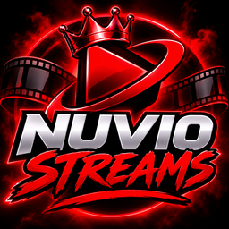

<div align="center">



# NuvioStreams

**A Stremio addon that finds high-quality streaming links from multiple sources.**


</div>

---

## Features

- Streams for **movies** and **TV series** inside Stremio
- **6 providers** searched in parallel, so results come back fast
- **HD, 1080p and 4K** sources
- **Subtitles** where a provider supplies them
- **Configuration page** to pick providers, minimum quality per provider and codec exclusions
- **Stream caching** to avoid repeat lookups and speed up results
- Each provider can be switched on or off from the page, or turned off server-wide with an environment variable

## Providers

| Provider | Quality | Notes |
| --- | --- | --- |
| ShowBox | HD / 4K | Direct links |
| 4KHDHub | 1080p / 4K | Direct links |
| HDHub4u | HD | Direct links |
| PlayIMDb | HD / 4K | Direct links |
| Cinejoy | 1080p / 4K | Direct links, subtitles |
| VAplayer | 1080p | Direct links, subtitles |

Providers depend on third-party sites, so any of them can stop working without notice. If one starts returning nothing, turn it off in the configuration page or with its environment flag.

## Installation

1. Open your addon's configuration page (your deployed URL, for example `https://your-addon.vercel.app`).
2. Choose the providers you want and set your quality preferences.
3. Click the install button, or copy the generated link and paste it into Stremio's addon search box.
4. Confirm the install in Stremio.

## Self-hosting

### Requirements

- Node.js 18 or newer
- A free [TMDB API key](https://www.themoviedb.org/settings/api)

### Run locally

```bash
git clone https://github.com/nick1234-design/NuvioStreamsAddon.git
cd NuvioStreamsAddon
npm install
```

Create a `.env` file in the project root:

```env
TMDB_API_KEY=your_tmdb_api_key_here
```

Then start the addon:

```bash
npm start
```

Open the address printed in the console to reach the configuration page.

### Deploy

The addon runs on any Node host. A Vercel deployment works too. After deploying, set the same environment variables in your host's dashboard and redeploy.

## Environment variables

| Variable | Required | Description |
| --- | --- | --- |
| `TMDB_API_KEY` | Yes | Used to look up titles and IMDb IDs |
| `ENABLE_CINEJOY_PROVIDER` | No | Set to `false` to disable Cinejoy server-wide |
| `ENABLE_VAPLAYER_PROVIDER` | No | Set to `false` to disable VAplayer server-wide |
| `ENABLE_PLAYIMDB_PROVIDER` | No | Set to `false` to disable PlayIMDb server-wide |

All `ENABLE_*_PROVIDER` flags default to enabled when they aren't set.

## Project structure

```
.
├── addon.js            # Addon logic: provider fetching, caching, filtering, formatting
├── manifest.json       # Stremio manifest (name, logo, resources)
├── views/
│   └── index.html      # Configuration page
├── providers/          # One file per provider
│   ├── cinejoy.js
│   ├── vaplayer.js
│   └── ...
└── nuvio-logo-256.png  # Addon logo
```

## Adding a provider

1. Create `providers/yourprovider.js` that exports an async function returning an array of streams:

   ```js
   // providers/yourprovider.js
   async function getYourProviderStreams(tmdbId, mediaType, season, episode) {
     // fetch and return: [{ name, title, url, quality, headers?, subtitles? }]
     return [];
   }
   module.exports = { getYourProviderStreams };
   ```

2. In `addon.js`, add an `ENABLE_*` flag, import the function, add a fetch function that follows the existing providers (cache check, fetch, cache save), and add the provider to the results and ordering lists.
3. In `views/index.html`, add a provider card and a checkbox with the matching `value` and a quality dropdown.

The easiest way is to copy an existing provider such as Cinejoy and change the names.

## Troubleshooting

| Problem | Fix |
| --- | --- |
| Logo doesn't change in Stremio | Remove the addon and install it again, since Stremio caches the manifest |
| A provider returns no streams | Its source site may be down or have changed. Try again later or disable it |
| No titles or poor results | Check that `TMDB_API_KEY` is set and valid |
| Config page loads but nothing installs | Make sure the deployed URL is HTTPS and reachable from your device |

## Disclaimer

This project does not host, store or upload any media. It only searches publicly available third-party sources and passes the links to your player. You are responsible for how you use it and for following the laws in your country. The maintainers are not affiliated with any provider listed above.

## Credits

Based on [tapframe/NuvioStreamsAddon](https://github.com/tapframe/NuvioStreamsAddon). Thanks to the original author and contributors for the foundation this project builds on.
